# agent-skills

Reusable skills for AI coding agents (Claude Code, Cowork and similar). Each folder is a self-contained skill: a `SKILL.md` with instructions, plus any scripts it needs.

## Skills

| Skill | What it does |
|---|---|
| [`course-generator-handwritten`](course-generator-handwritten/SKILL.md) | Turns a topic, book/PDF or research into narrated, hand-drawn whiteboard explainer videos and multi-lecture courses: black canvas, neon doodles drawn stroke by stroke, rough handwriting, ~1.2x voiceover. |

## How `course-generator-handwritten` works

```mermaid
flowchart LR
    A["📚 Source<br/>topic · PDF · research"]:::src --> B["🔎 Research<br/>verify facts + numbers"]:::research
    B --> C["✍️ spec.js<br/>narration + visuals<br/>per lecture"]:::spec
    C --> D["🎙️ Voiceover<br/>any TTS API<br/>~1.2x pace"]:::voice
    D --> E["🎨 Engine<br/>rough.js doodles<br/>synced to words"]:::engine
    E --> F{"🔍 QA stills<br/>layout OK?"}:::qa
    F -- "no: fix spec" --> C
    F -- yes --> G["🎬 Render<br/>Playwright + ffmpeg"]:::render
    G --> H["📦 Course<br/>MP4s + subtitles"]:::out

    classDef src fill:#6fb7ff,stroke:#1e3a5f,color:#000
    classDef research fill:#8c7dff,stroke:#2e2470,color:#fff
    classDef spec fill:#f2ef6a,stroke:#6b6a10,color:#000
    classDef voice fill:#ff5ad9,stroke:#6b1059,color:#000
    classDef engine fill:#ffa53d,stroke:#6b3f05,color:#000
    classDef qa fill:#ffffff,stroke:#ff5ad9,stroke-width:3px,color:#000
    classDef render fill:#8af07a,stroke:#1f5a17,color:#000
    classDef out fill:#000000,stroke:#8af07a,stroke-width:3px,color:#8af07a
```



1. **Research**: every number, date and name is checked against primary sources.
2. **Write a spec**: each lecture is one `spec.js` with a hook, a 3–7 layer framework, sections of beats (narration + diagram items), and a recap.
3. **Voiceover**: each beat is voiced through any OpenAI-compatible `/audio/speech` endpoint, trimmed and paced to about 1.2x.
4. **Engine**: hand-drawn items are laid out automatically and timed to the exact spoken words.
5. **QA**: end-of-beat stills are tiled into contact sheets; fix overlaps before rendering.
6. **Render**: frames are captured with Playwright, then ffmpeg muxes the video, audio and subtitles.

## Quick start

```bash
cp -r course-generator-handwritten/engine ~/course && cd ~/course
npm i && cp .env.example .env            # add your TTS_API_KEY / TTS_MODEL / TTS_VOICE
./build.sh L00_Intro                     # voice + scenes
./qa.sh L00_Intro                        # check layout stills
./render_lecture.sh L00_Intro "00 - Intro"
```

Credentials live only in your local `.env` (gitignored). Never commit keys.
