# Course generator: handwritten explainer videos

Turns a topic, a book or PDF, or research into narrated, hand-drawn whiteboard explainer videos and multi-lecture courses: black canvas, neon doodles drawn stroke by stroke, and a voiceover with every drawing timed to the spoken word.

## How it works

```mermaid
flowchart LR
    A["Source<br/>topic / PDF / research"]:::src --> B["Research<br/>verify facts"]:::research
    B --> C["spec.js<br/>narration + visuals"]:::spec
    C --> D["Voiceover<br/>text to speech, ~1.2x pace"]:::voice
    D --> E["Engine<br/>hand-drawn, word-synced"]:::engine
    E --> F{"Layout check<br/>stills OK?"}:::qa
    F -- no --> C
    F -- yes --> G["Render<br/>Playwright + ffmpeg"]:::render
    G --> H["Course<br/>MP4 + subtitles"]:::out

    classDef src fill:#6fb7ff,stroke:#1e3a5f,color:#000
    classDef research fill:#8c7dff,stroke:#2e2470,color:#fff
    classDef spec fill:#f2ef6a,stroke:#6b6a10,color:#000
    classDef voice fill:#ff5ad9,stroke:#6b1059,color:#000
    classDef engine fill:#ffa53d,stroke:#6b3f05,color:#000
    classDef qa fill:#ffffff,stroke:#ff5ad9,stroke-width:3px,color:#000
    classDef render fill:#8af07a,stroke:#1f5a17,color:#000
    classDef out fill:#000000,stroke:#8af07a,stroke-width:3px,color:#8af07a
```



## Requirements

Node 20+, Python 3, ffmpeg, and an OpenAI-compatible text-to-speech API key. Playwright, Chromium, numpy and soundfile are installed in the next step.

## Configure

The engine runs from its own working folder, `~/course`, so lecture audio and videos stay out of your skills folder.

```bash
cp -r ~/.claude/skills/course-generator-handwritten/engine ~/course
cd ~/course
npm i && npm run browsers          # installs Playwright and Chromium
python3 -m pip install soundfile numpy
cp .env.example .env               # set TTS_API_KEY, TTS_MODEL, TTS_VOICE (optionally TTS_URL)
```

`.env` is gitignored. Never commit keys.

## Use

In Claude Code, either call the skill directly:

```
/course-generator-handwritten Make a 3-lecture course on vector databases
```

or just ask, and Claude picks the skill up automatically:

```
Turn the attached PDF into a handwritten explainer course, one video per chapter.
```

Claude researches the topic, writes the lecture specs, voices them, checks the layouts and renders. You get numbered MP4s with subtitles.

## How the lectures are designed

The teaching rules follow published research on learning from video and the World Wide Web Consortium's accessibility guidance: lectures of 6 minutes of speech or less, a quick recall question before each recap, and key words on screen with everything that matters said aloud, so the narration doubles as audio description. The evidence, its limits and the sources are in [references/learning-design.md](references/learning-design.md).

## Tests

The narration extractor, its spec checks and the lecture length warning are tested (Node must be installed):

```bash
python3 -m unittest discover -s course-generator-handwritten/tests
```
